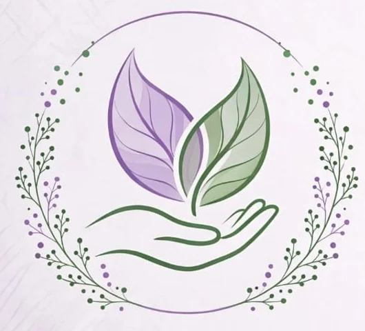

# Do Carmo HumanYs · Massoterapia

Site institucional da **Do Carmo HumanYs Massoterapia**, criado para apresentar o espaço, explicar a proposta de atendimento e facilitar o contato para agendamentos.



## Sobre o projeto

Uma página leve e responsiva, em português, com foco em bem-estar, acolhimento e acesso rápido às informações da empresa.

### Recursos

- Layout adaptado para celular, tablet e desktop
- Navegação por seções com menu móvel
- Atalhos de contato para WhatsApp, telefone, e-mail e Instagram
- Link para localização no Google Maps
- Imagens otimizadas em WebP
- Respeito à preferência do dispositivo por movimento reduzido

## Tecnologias

- HTML5
- CSS3
- JavaScript
- Google Fonts: DM Sans e Lora

## Estrutura

```text
.
├── index.html
├── README.md
└── images/
    ├── logo-emblema.webp
    ├── sala-massoterapia.webp
    └── sessao-massoterapia.webp
```


## Contato

Os canais de atendimento estão disponíveis no site.
